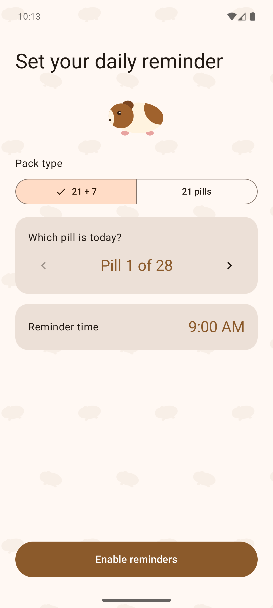
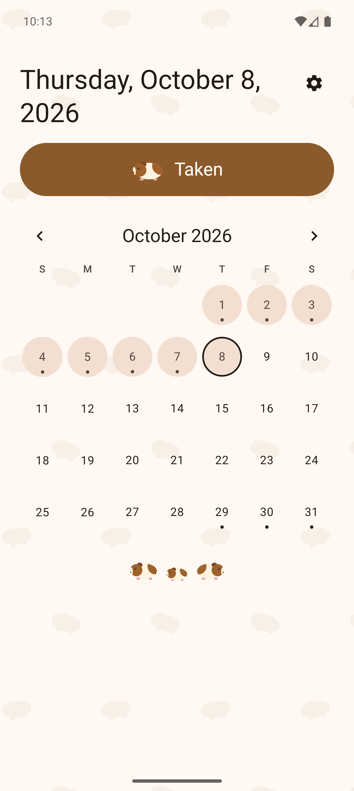
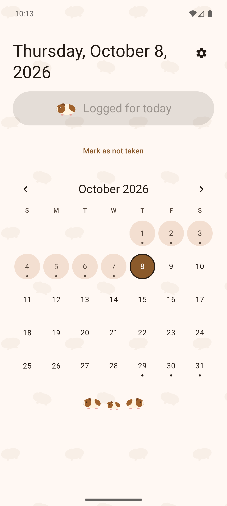
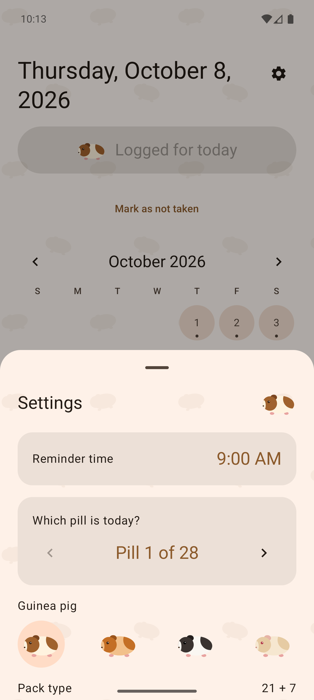
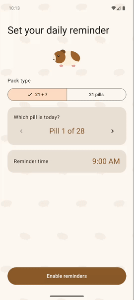

#  PillTracker

A private, fully offline Android app that reminds you to take your daily pill and keeps a simple history.

**Privacy by construction:** the app declares no network permissions, disables cloud backup, and contains no analytics or third-party network SDKs. CI fails the build if that ever changes. See [ADR 0001](docs/adr/0001-local-only-no-network.md).

## Why I built this app?

This app was inspired by one of my wife's frustrations. Every app designed to track birth control pill usage included features that she was not interested in using. She told me the only features she needed.

1. A notification on her phone to remind her to take the pill.
2. Initial configuration to set the type of pill she was taking.
3. A calendar to keep track of the days she took the pill.
1. The app was full of guinea pigs.

I decided to build this app using Claude Code, but all the technical and product decisions were made by humans.

## Screenshots

| Setup | Home | Logged | Settings |
|---|---|---|---|
|  |  |  |  |

### Quick demo



[Full-quality video](docs/images/demo.mp4)

## Status
MVP: setup, daily reminder with a Taken action, one-tap logging with the month grid on Home, and a settings sheet (reminder time, pack realignment, delete all data). English and Spanish.

## Docs
- [Spec](docs/spec.md): features and acceptance criteria
- [CLAUDE.md](CLAUDE.md): rules the coding agent follows
- [ADRs](docs/adr/): architecture decisions
- [Open questions](docs/open-questions.md)

## Release build
The signing key never goes in git. Put it in `~/.gradle/gradle.properties`:
```
pilltracker.storeFile=/absolute/path/to/release.jks
pilltracker.storePassword=...
pilltracker.keyAlias=...
pilltracker.keyPassword=...
```
Then `./gradlew assembleRelease` gives a signed, R8-shrunk `app/build/outputs/apk/release/app-release.apk`. Without the properties it builds unsigned. Keep a backup of the keystore: updates must be signed with the same key.

## Verify the privacy claim
```
bash scripts/check-no-network-permission.sh .
```
After building, inspect the merged manifest or run `aapt dump permissions app-release.apk`: no `INTERNET`.

## Verify a downloaded APK
Releases are signed with a single key. Before installing, check that the APK was signed by it:
```
apksigner verify --print-certs app-release.apk
```
The `Signer #1 certificate SHA-256 digest` must be:
```
b7aeb7ed4a327e5464a84df9e06c1735a8d591b7febe2b1c9d19a19549a90774
```
If it differs, do not install it. Android will also refuse to update an installed copy with an APK signed by a different key.

## Supply chain
Every Gradle dependency and the Gradle distribution itself are pinned by SHA-256 (`gradle/verification-metadata.xml`, `gradle-wrapper.properties`), so a tampered artifact fails the build. See [dependencies](docs/dependencies.md).

## License
GPL-3.0-or-later. See [LICENSE](LICENSE). Anyone who distributes this app or a modified version must also release the source code under the same license.
